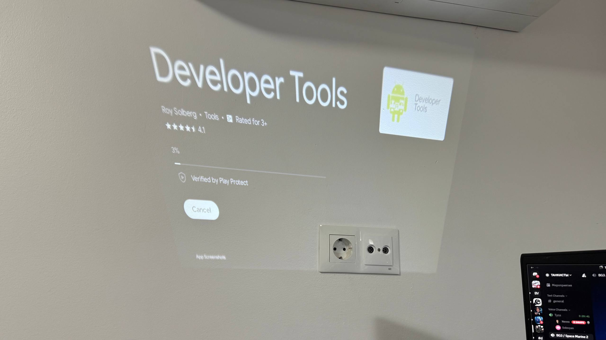
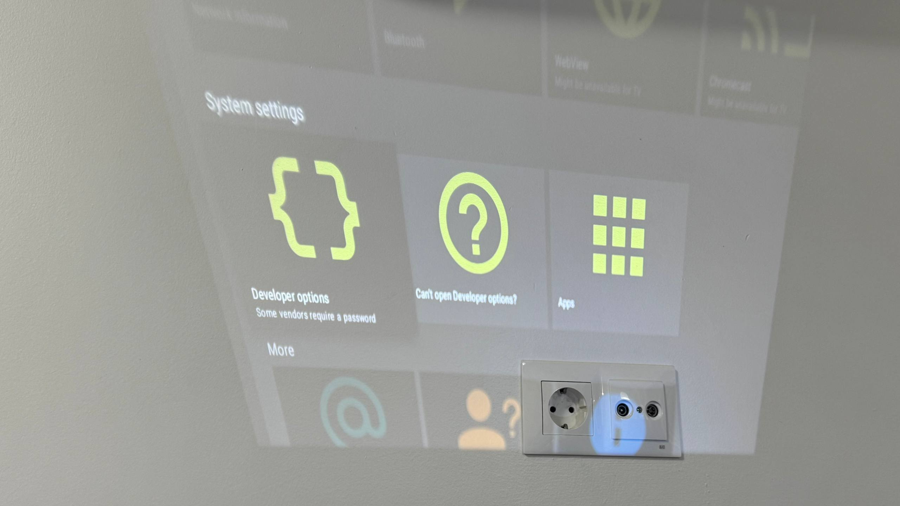
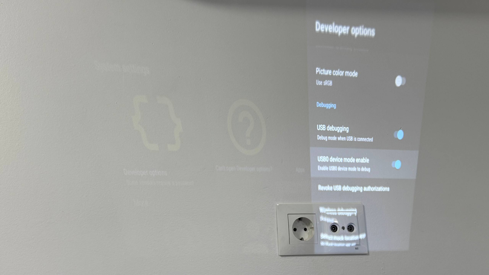
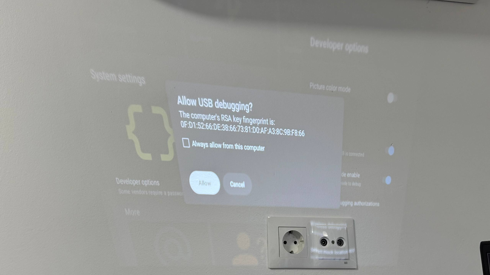
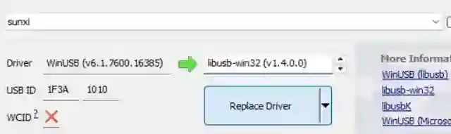

# Allwinner H723 Android root access — H723-6621-V1.2 / V1.3

A reproducible hardware/software guide based on a real rooting session on an Android board built around **Allwinner H723 / sun50iw15p1**.

**Successfully tested hardware: H723-6621-V1.2 and H723-6621-V1.3.** This original guide records the V1.2 session; the [independently verified V1.3 rooting session](docs/h723-6621-v1.3-verified-root.md) documents its own firmware hashes, Magisk v30.7 offline patch method, Windows USB driver troubleshooting and final root. **Do not reuse firmware images or Secure Storage hashes between boards.** A board sold/marked as **H723-CY-4D308** looks very similar, but it has **not** been verified by this repository. Treat it as a different target until its GPT, boot layout and Secure Storage contents have been read and checked.

> [!CAUTION]
> This procedure includes raw eMMC writes. A wrong LBA, a wrong firmware image, or a power loss at the wrong moment can brick the board. The public scripts in this repository are deliberately conservative: they validate hashes/CRCs, default to read-only/dry-run behavior, and do not reboot automatically after critical writes.

# 1. Enable Developer Tools and USB debugging on the projector (before ADB)

**Start here on stock Android. USB debugging is initially OFF, so ADB cannot work yet.** Do not start with `adb devices` or `adb reboot recovery`.

1. Open **Google Play** on the projector, find **Developer Tools** by **Roy Solberg**, install it and launch it.

   

2. In the app choose **Developer options** (curly-braces icon). This opens Android's developer settings, which may be missing from the projector's regular Settings menu.

   

3. Under **Debugging**, turn on both **USB debugging** and **USB0 device mode enable** (as labeled in this tested H723 firmware). They are two separate switches.

   

**Do not attempt ADB yet.** The projector-side prerequisites are now enabled; next, install Android Platform Tools on your Windows computer (step 2), make the physical USB data connection, and authorize the computer when its first ADB request triggers the RSA dialog (step 3).

---

# 2. Host setup

Examples use Windows PowerShell because that is how the board was tested.

Install:

- Android Platform Tools (`adb.exe` in the parent directory of this repository)
- Python 3
- a USB-UART adapter capable of 3.3 V logic
- `pyserial`
- `pyusb`

```powershell
python -m pip install -r requirements.txt
```

**Layout used in the verified Windows session:** `adb.exe` (from Android Platform Tools) is in the **parent folder** of this cloned repository; all commands below run from the repository root and use `..\\adb.exe`. If you keep it elsewhere, adjust that path consistently. The Magisk batch script `patch_init_boot.cmd` expects `..\\adb.exe`.

**Connect the PC only after enabling USB debugging and USB0 device mode in step 1.** Use the tested physical USB data wiring on the PCB (not a charge-only cable), keep UART on its own adapter, and never connect two independent +5 V sources. The first `adb devices -l` request triggers the authorization on the projector.

For the Allwinner bootloader interface on Windows, PyUSB must be able to claim USB device `1f3a:1010`. If Python cannot see it, a libusb-compatible driver may be required for that interface.

Do not start any raw-write step until you have working UART access and verified backups.

---

# 3. Start in normal Android

Check ADB **after** finishing projector settings (step 1) and installing Platform Tools plus connecting USB data (step 2):

```powershell
..\adb.exe devices -l
```

If Android shows **"Allow USB debugging?"** with the PC RSA key fingerprint, select **Allow** (and optionally **Always allow from this computer** on a trusted PC), then run `adb devices -l` once more. Proceed only when the state is **`device`**, not `unauthorized` or empty.



**Prerequisite:** enable both USB debugging and USB0 device mode, connect physical USB data, and authorize the PC RSA key. All following ADB commands use this same **physical USB connection**, including Recovery.

Capture basic properties before changing anything:

```powershell
..\adb.exe shell getprop ro.build.version.release
..\adb.exe shell getprop ro.build.version.sdk
..\adb.exe shell getprop ro.product.cpu.abi
..\adb.exe shell getprop ro.boot.slot_suffix
..\adb.exe shell getprop ro.boot.vbmeta.device_state
..\adb.exe shell getprop ro.boot.verifiedbootstate
..\adb.exe shell getprop ro.boot.veritymode
..\adb.exe shell uname -a
..\adb.exe shell getprop > getprop-stock.txt
```

Keep the UART adapter connected and start a boot-log capture before rebooting:

```powershell
python .\scripts\uart_log_capture.py COM5 --out boot-before-unlock.log
```

Use your actual COM port.

---

# 4. Enter recovery correctly

Request recovery from the currently running Android:

```powershell
..\adb.exe reboot recovery
```

The tested board enters Recovery on reboot. Keep the **physical USB data connection** and UART attached; do not switch to physical USB ADB.

```powershell
..\adb.exe devices -l
..\adb.exe shell id
```

If ADB is not present in Recovery, check the physical USB wiring and host USB driver. UART remains available for the recovery shell, boot logs and eMMC dump; do not perform writes until both paths are verified.

Keep UART connected at the same time. The original raw-eMMC tools use the recovery UART shell.

---

# 5. Discover the partition table instead of guessing

Do not start with `mmcblk0p5`, `p9`, etc. Those numbers came from **this** unit's GPT and must be rediscovered on another board/firmware.

The original session read the first 34 eMMC sectors from the recovery UART shell. The hardened equivalent is:

```powershell
python .\scripts\uart_dump.py COM5 --skip 0 --count 34 --out gpt34.bin
```

Then validate and parse it:

```powershell
python .\scripts\gpt_inspect.py .\gpt34.bin
```

`gpt_inspect.py` verifies:

- MBR signature `55 aa`;
- GPT signature `EFI PART`;
- GPT header CRC32;
- partition-entry-array CRC32;
- entry bounds and sizes.

For the supplied test-unit GPT the validation result is:

```text
GPT header CRC32:        6ad342cd
partition array CRC32:   534057f5
partition entries:       29 x 128 bytes
```

The complete verified partition map is in [`docs/partition-map.md`](docs/partition-map.md).

The partitions that matter most to this procedure on the tested `_a` slot are:

| Partition | Linux node on tested unit | First LBA | Sectors | Size | Why it matters |
|---|---|---:|---:|---:|---|
| `env_a` | `mmcblk0p3` | 204800 | 512 | 256 KiB | confirms slot/boot environment |
| `boot_a` | `mmcblk0p5` | 205824 | 131072 | 64 MiB | contains the kernel-side boot image |
| `vendor_boot_a` | `mmcblk0p7` | 467968 | 65536 | 32 MiB | split Android boot layout backup |
| `init_boot_a` | `mmcblk0p9` | 599040 | 16384 | 8 MiB | generic ramdisk; Magisk target |
| `misc` | `mmcblk0p12` | 5874688 | 32768 | 16 MiB | recovery/bootloader boot commands |
| `vbmeta_a` | `mmcblk0p13` | 5907456 | 256 | 128 KiB | AVB metadata; backup before experiments |

You can have the parser print read-only backup commands from **your** GPT:

```powershell
python .\scripts\gpt_inspect.py .\gpt34.bin --dump-plan COM5
```

---

# 6. Why these partitions were selected

The choice was not based only on Android conventions.

The recovered `env_a` image contains:

```text
slot_suffix=_a
ab_partition_list=bootloader,env,boot,vendor_boot,dtbo,vbmeta,vbmeta_system,vbmeta_vendor,init_boot,Reserve0
boot_fastboot=fastboot
```

The U-Boot log independently showed:

```text
partinfo: name boot_a, start 0x32400, size 0x20000
androidboot.slot_suffix=_a
ramdisk use init boot
pubkey vbmeta_a valid
```

Therefore:

- active slot was `_a`;
- `boot_a` contains the kernel-side image; **it is not part of the root-modification or required backup workflow**;
- the generic ramdisk came from `init_boot_a`, so that is the correct Magisk target;
- `vbmeta_a`, `vendor_boot_a`, `misc` and `env_a` are important recovery/reference backups even though the final Magisk flash only wrote `init_boot_a`.

See [`docs/boot-chain.md`](docs/boot-chain.md).

---

# 7. Back up the required **small** partitions — not `boot_a`

Work from your **own validated GPT**, after recovery UART is working and before any write. The root method modifies Secure Storage and `init_boot_a`; it does **not** modify the 64 MiB kernel-side `boot_a` image. **Do not dump `boot_a` over 115200-baud UART for this guide.**

### 6.1 Extract `init_boot_a` (8 MiB)

```powershell
python .\scripts\uart_dump.py COM5 `
  --skip 599040 `
  --count 16384 `
  --out init_boot_a-stock.img
```

The expected size from the tested GPT is `8,388,608` bytes. The original **V1.2** image SHA-256 is `2d0b2683e03e3edea8e5e47426e23088e0f0da112f2c597ac84e6e400873dca0`. For the independently tested **V1.3**, the stock SHA-256 is `624a3a0609ecbc7650d8371e73c5542397923f9e0a23c15e85f3342606a0319c`. **Your own image may differ; verify its header, size and computed hash.**

Keep the untouched verified stock backup, then make a copy for patching:

```powershell
Copy-Item .\init_boot_a-stock.img .\init_boot_a.img
Get-FileHash .\init_boot_a.img -Algorithm SHA256
```

### 6.2 Back up only other required small regions

Save `env_a`, `vbmeta_a`, and the 128 KiB Secure Storage region at the read-only discovery stage, using the exact verified offsets from your board. Optional small partitions can be saved for recovery if necessary. For the GPT-based read-only dump plan:

```powershell
python .\scripts\gpt_inspect.py .\gpt34.bin --dump-plan COM5
```

**Do not execute every generated dump command blindly**: the plan can include the 64 MiB `boot_a` partition, which is deliberately excluded here. Keep `init_boot_a-stock.img`, `env_a-stock.img`, `vbmeta_a-stock.img`, `h723-secure-storage-original.bin`, and `gpt34.bin` offline with verified hashes.

The updated UART dumper shows a progress/ETA display and attempts to interrupt a stale remote `dd | base64` process on Ctrl+C. If recovery cannot be confirmed, restore a responsive recovery shell **before** another attempt.

---
 
# 8. Confirm the original LOCKED/GREEN state

Before the Secure Storage modification, the captured U-Boot log showed that the two unlock items were absent:

```text
no item name device_unlock in the map
no item name fastboot_status_flag in the map
sunxi secure storage has no flag
```

AVB still verified normally and U-Boot reported the same `vbmeta_a` public-key path used later:

```text
pubkey vbmeta_a valid
androidboot.vbmeta.device_state=locked
androidboot.veritymode=enforcing
androidboot.verifiedbootstate=green
```

Analyze your saved UART log with:

```powershell
python .\scripts\avb_log_check.py .\boot-before-unlock.log
```

This establishes the pre-write baseline.

---

# 9. Dump Allwinner Secure Storage

On the tested H723-6621-V1.2 firmware, the validated Secure Storage region was:

```text
start LBA: 12288
size:      256 sectors = 128 KiB
```

Read it first:

```powershell
python .\scripts\uart_dump.py COM5 `
  --skip 12288 `
  --count 256 `
  --out h723-secure-storage-original.bin
```

The original test-unit SHA-256 was:

```text
cc86b0255f07e9cec320285df83899a51354698c70003a8b1b1e56c807820490
```

> [!WARNING]
> LBA 12288 is verified for this unit/firmware. On another board, treat it as a **read-only probe first**. Do not write there until the parser validates the structure and you have saved the original bytes somewhere safe.

Verify:

```powershell
python .\scripts\secure_storage_tool.py verify .\h723-secure-storage-original.bin
```

The public verifier checks:

- exact 128 KiB size;
- observed Allwinner magic;
- map CRC;
- primary/backup map equality;
- item bounds;
- duplicate names;
- item CRCs;
- primary/backup item equality.

---

# 10. Build the unlock candidate

Create the candidate from **your own original dump**:

```powershell
python .\scripts\secure_storage_tool.py patch `
  .\h723-secure-storage-original.bin `
  .\h723-secure-storage-unlocked.bin
```

The successful session added exactly these two plaintext entries:

```text
fastboot_status_flag = unlocked
device_unlock        = unlock
```

Then verify the generated image and the exact values:

```powershell
python .\scripts\secure_storage_tool.py verify `
  .\h723-secure-storage-unlocked.bin `
  --require-unlock
```

For the test-unit dump the patched result had:

```text
SHA-256:
28a017814d6af136ab18f5f76396af4cd37f20cd407abfb613b0e4968c27fcc4
```

Do not expect the same hashes from a different legitimate firmware. The values above identify this test unit's exact captures; they are not universal H723 hashes.

---

# 11. Audit the live Secure Storage before writing

The public writer is read-only unless `--write` is supplied.

For the exact test-unit dump/candidate:

```powershell
python .\scripts\secure_storage_write_uart.py COM5 `
  .\h723-secure-storage-unlocked.bin `
  --secure-lba 12288 `
  --expected-live-sha256 cc86b0255f07e9cec320285df83899a51354698c70003a8b1b1e56c807820490 `
  --expected-candidate-sha256 28a017814d6af136ab18f5f76396af4cd37f20cd407abfb613b0e4968c27fcc4 `
  --backup-dir .\backup
```

Without `--write` it:

1. reads live Secure Storage again;
2. saves another timestamped backup;
3. requires the exact source SHA-256 you supplied;
4. checks the exact candidate SHA-256;
5. calculates which 4 KiB blocks differ;
6. prints the planned commit order;
7. writes nothing.

For the successful test-unit pair, the changed blocks are:

```text
0, 1, 8, 9, 10, 11
```

and the safe commit order is:

```text
8, 9, 10, 11, 1, 0
```

That order means:

```text
new item primary/backup copies
    -> backup map
    -> primary map LAST
```

---

# 12. Write the unlock candidate

Only after the read-only audit matches exactly:

```powershell
python .\scripts\secure_storage_write_uart.py COM5 `
  .\h723-secure-storage-unlocked.bin `
  --secure-lba 12288 `
  --expected-live-sha256 cc86b0255f07e9cec320285df83899a51354698c70003a8b1b1e56c807820490 `
  --expected-candidate-sha256 28a017814d6af136ab18f5f76396af4cd37f20cd407abfb613b0e4968c27fcc4 `
  --expected-changed-blocks 8,9,10,11,1,0 `
  --backup-dir .\backup `
  --write
```

The writer then:

1. repeats the source/candidate safety checks;
2. tests `base64 -d` in the remote shell without touching eMMC;
3. opens the eMMC block device with `count=0` to test write access without transferring data;
4. writes only the expected changed 4 KiB blocks;
5. calls `sync`;
6. immediately reads every written 4 KiB block back and compares byte-for-byte;
7. rereads the entire 128 KiB region;
8. requires exact equality with the candidate;
9. does **not** reboot the board.

If any read-back fails, stop and **do not reboot**.

The original session writer is preserved in [`reference/session-scripts/h723_secure_write_uart.py`](reference/session-scripts/h723_secure_write_uart.py). It is intentionally hard-coded to the known test-unit hashes; use the public writer for new boards.

---

# 13. Reboot and verify GREEN -> ORANGE

After the complete Secure Storage read-back passes, keep UART capture running and reboot manually.

Before the patch U-Boot had reported the two items missing. After the patch it showed the corresponding entries and:

```text
find fastboot unlock flag
```

The captured unlocked boot path included:

```text
Your device software can't be checked for corruption.
Please lock the bootloader.
orange state:start to display bootlogo
androidboot.vbmeta.device_state=unlocked
androidboot.veritymode=enforcing
androidboot.verifiedbootstate=orange
```

Run:

```powershell
python .\scripts\avb_log_check.py .\boot-after-unlock.log
```

The expected result is:

```text
device_unlock item:        present
fastboot_status_flag item: present
fastboot unlock flag:      found
device_state:              unlocked
verifiedbootstate:         orange
veritymode:                enforcing
RESULT: UNLOCKED / ORANGE
```

## What did *not* cause the orange state

The transition happened **before the Magisk ramdisk patch**.

The observed `vbmeta` digest was the same before and after the transition:

```text
8350ea2274ca1891b0dbd686b8254840b627e24ab72e8ce4211de492b6eb37c9
```

`veritymode` remained `enforcing`.

Therefore the working green-to-orange procedure did **not** require zeroing `vbmeta_a`, disabling dm-verity, flashing a random `vbmeta`, installing Magisk, or patching the kernel merely to change the verified-boot color. The state change came from the Allwinner Secure Storage unlock flags consumed by U-Boot.

---

# 14. Continue from ORANGE to Magisk

After the Secure Storage write has been fully read back and the next UART boot confirms:

```text
androidboot.vbmeta.device_state=unlocked
androidboot.verifiedbootstate=orange
androidboot.veritymode=enforcing
```

continue with the stock `init_boot_a` image. A separate `boot_a` kernel binary patch is not part of the documented root procedure.

There is **no requirement to dump or back up the 64 MiB `boot_a`** in this root workflow. Only `init_boot_a` is the Magisk target.

---

# 15. Verify the correct Magisk target

The **V1.2** stock `init_boot_a` used for the original test is an Android boot image v4 (the later V1.3 firmware has a **different** SHA-256):

```text
stock init_boot_a.img
size:           8,388,608 bytes
header version: 4
kernel size:    0
ramdisk size:   3,346,935 bytes
SHA-256:        2d0b2683e03e3edea8e5e47426e23088e0f0da112f2c597ac84e6e400873dca0
```

The U-Boot line:

```text
ramdisk use init boot
```

is the reason `init_boot_a`, not `boot_a`, is the Magisk ramdisk target on this firmware.

You can inspect your **own** 8 MiB stock image with:

```powershell
python .\scripts\init_boot_inspect.py .\init_boot_a.img
```

---

# 16. Patch `init_boot_a` with Magisk — tested offline method (V1.3)

**The Magisk GUI "Select and Patch a File" did not work on the tested Android 14 projector.** It invoked the vendor `com.softwinner.TvdFileManager` and produced no patched image. **Do not rely on the GUI file picker.** The working path is the repository's **ARM32 offline patch scripts**, using the original Magisk v30.7 APK and the device's *own* 8 MiB `init_boot_a`.

1. Obtain the official **Magisk v30.7 APK** from the [Magisk releases](https://github.com/topjohnwu/Magisk/releases) and save it at `Magisk-v30.7.apk` in the repository root. Install the app on the projector via physical USB ADB:

   ```powershell
   ..\adb.exe install -r .\Magisk-v30.7.apk
   ```

2. From your **own previously extracted stock image**, create the input name expected by the patcher (do not use V1.2 images on V1.3):

   ```powershell
   Copy-Item .\init_boot_a-stock.img .\init_boot_a.img
   python .\scripts\init_boot_inspect.py .\init_boot_a.img
   ```

   For the tested **V1.3**, the stock image was 8,388,608 bytes, boot header v4, SHA-256 `624a3a0609ecbc7650d8371e73c5542397923f9e0a23c15e85f3342606a0319c`. Other devices can legitimately differ.

3. Extract ARM32 patch binaries and `boot_patch.sh` from the local official APK, then run the included batch file while the projector is booted in **normal Android with USB ADB**:

   ```powershell
   python .\scripts\extract_magisk_arm32.py .\Magisk-v30.7.apk
   .\patch_init_boot.cmd
   ```

   `extract_magisk_arm32.py` creates `mp/` with the required `armeabi-v7a` binaries and scripts. `patch_init_boot.cmd` pushes the tools and `init_boot_a.img` to `/data/local/tmp/mp/`, runs Magisk `boot_patch.sh` via BusyBox on-device, and pulls **`magisk_patched_init_boot_a.img`** back to the repository directory. **These scripts do not flash eMMC.** The Magisk app must be installed for final first-boot setup, but its file picker is not used.

4. Inspect the output and calculate its **own** SHA-256:

   ```powershell
   python .\scripts\init_boot_inspect.py .\magisk_patched_init_boot_a.img
   (Get-FileHash .\magisk_patched_init_boot_a.img -Algorithm SHA256).Hash.ToLowerInvariant()
   ```

   The successfully tested V1.3 patched image was **8,388,608 bytes**, boot v4, ramdisk **3,281,800 bytes**, SHA-256 `e9e9015493ecfa35f77dc5d79363c745033ab9b695a0be47a1b53f0a06898331`, with `/.magisk`, `PREINITDEVICE=`, and `init-ld.xz` markers.

**Never flash another board's patched image or copy its SHA into your own flash command.** Keep the original stock image offline so `init_boot_a` can be restored if needed.

---

# 17. Enter Allwinner USB Fastboot and configure Zadig (Windows)

From normal Android over the already authorized **physical USB ADB** connection:

```powershell
..\adb.exe reboot bootloader
```

Now the device changes from Android ADB to the **Allwinner fastboot USB interface**: `sunxi`, **VID:PID `1F3A:1010`**, interface `FF/42/03`, Bulk IN `0x81`, OUT `0x02`. ADB commands will not work while in this mode.

On the tested Windows PC, Zadig was needed because PyUSB could not initially access `sunxi` with the existing driver. **Use Zadig on exactly this USB ID, not on the normal Android ADB interface**:

1. Open [Zadig](https://zadig.akeo.ie/), select **Options → List All Devices** if necessary, then choose **sunxi**.
2. **Verify VID `1F3A`, PID `1010`.** Choose **libusb-win32** as the replacement driver and click **Replace Driver**. The tested screenshot showed `WinUSB` → `libusb-win32`.
3. On Windows PowerShell, verify both the Python backend and USB device enumeration:

   ```powershell
   python -c "import usb.backend.libusb0 as b; print(b.get_backend())"
   python -c "import usb.core; print(usb.core.find(idVendor=0x1F3A, idProduct=0x1010))"
   ```

   Expected: a `usb.backend.libusb0._LibUSB` object and a USB device descriptor containing `1f3a:1010`, `sunxi`, and `Android Bootloader Interface`. If `None` is returned, **do not flash**; the driver/backend is not ready.



This change applies to the **bootloader's USB interface**; it is not an instruction to replace the working Android ADB driver. Host drivers can differ, but this is the configuration actually used for the successful V1.3 flash.

---

# 18. Test the fastboot client before writing (dry-run)

Do **not** add `--yes` until the dry-run passes. In PowerShell, generate the SHA-256 from **your exact patched file**, then run the repository's hash-gated fastboot script:

```powershell
$imageSha = (Get-FileHash .\magisk_patched_init_boot_a.img -Algorithm SHA256).Hash.ToLowerInvariant()
python .\scripts\awfastboot_flash.py .\magisk_patched_init_boot_a.img `
  --partition init_boot_a `
  --size 8388608 `
  --sha256 $imageSha
```

The verified V1.3 run reported:

```text
Image size: 8388608
> getvar:max-download-size
< 'OKAY0x02000000'
DRY RUN PASS. Would flash init_boot_a. Nothing was written.
```

The script confirms the image size/hash, discovers `sunxi 1f3a:1010`, communicates over `ff/42/03` and **does not modify firmware** in dry-run.

---

# 19. Flash only `init_boot_a`

**Only after `DRY RUN PASS`**, add `--yes` to the same command. Keep the projector powered throughout:

```powershell
$imageSha = (Get-FileHash .\magisk_patched_init_boot_a.img -Algorithm SHA256).Hash.ToLowerInvariant()
python .\scripts\awfastboot_flash.py .\magisk_patched_init_boot_a.img `
  --partition init_boot_a `
  --size 8388608 `
  --sha256 $imageSha `
  --yes
```

Successful V1.3 fastboot transcript:

```text
> getvar:max-download-size
< 'OKAY0x02000000'
> download:00800000
< 'DATA00800000'
8388608/8388608
< 'OKAY'
> flash:init_boot_a
< 'OKAY'
FLASH OK. No reboot command was sent.
```

**Only `init_boot_a` is written. Never flash or back up the 64 MiB `boot_a` for this procedure.** The script does **not** reboot the projector; reboot it manually after the confirmed `FLASH OK`.

---

# 20. Open Magisk, finish additional setup, reboot — then verify root

**Flashing the patched image is not the last step. On the V1.3 test, `su` was still missing immediately after the first Android boot.** The working final procedure was:

1. After flashing completes and Android boots, **open the Magisk application on the projector**.
2. The application displays **"Requires additional setup"** and asks **"Do you want to proceed and reboot?"** Tap **OK**. **Allow Magisk to complete this additional installation and reboot the projector.**
3. Once Android starts again, connect physical USB ADB and run:

   ```powershell
   ..\adb.exe devices -l
   ..\adb.exe shell "su -c 'id'"
   ```

4. The projector will show **Magisk → Superuser request** for **`[Shared UID] Shell / com.android.shell`**. Choose the desired authorization duration (on the tested unit, **Forever**) and tap **GRANT**. Run the same `su` command again if the prompt interrupted the command.


The confirmed successful V1.3 result was:

```text
uid=0(root) gid=0(root) groups=0(root) context=u:r:magisk:s0
```

**This root result is only achieved after the Magisk additional setup/reboot and Superuser grant.** A missing `su` immediately after flashing is not, by itself, proof that flashing failed.

---

# 21. Recovery checklist

Before the first destructive write, keep these offline:

```text
gpt34.bin
env_a-stock.img
init_boot_a-stock.img
vbmeta_a-stock.img
h723-secure-storage-original.bin
SHA256SUMS-stock.txt
```

Do not casually write an entire image to `/dev/block/mmcblk0`. The successful Secure Storage writer changed only the necessary 4 KiB blocks and verified each one immediately.

If a Secure Storage read-back fails, **do not reboot**. If a later boot image fails, restore only the exact partition you changed from its verified stock backup.

---

# 22. H723-CY-4D308 and other similar boards

`H723-CY-4D308` has been reported as visually very similar to the tested `H723-6621-V1.2`, but this repository does not claim binary compatibility.

Before reusing any write command on a similar board:

1. get UART working;
2. boot recovery and use physical USB ADB, not physical USB ADB;
3. dump/validate its own GPT;
4. compare partition names/sizes;
5. dump its own **stock `init_boot_a`** (8 MiB); no `boot_a` dump is required;
6. read LBA 12288 only as a read-only Secure Storage probe;
7. require the Secure Storage parser to validate the structure;
8. create new hashes from that board;
9. patch its own `init_boot_a` with Magisk;
10. never flash an image from the H723-6621-V1.2 test unit merely because the PCB looks similar.

---

## Repository layout

```text
.
├── README.md
├── requirements.txt
├── patch_init_boot.cmd
├── images/
│   ├── README.md
│   ├── h723-6621-v1.2-uart-location.jpg
│   ├── h723-6621-v1.2-usb-adb-wiring.jpg
│   ├── h723-6621-v1.3-zadig-libusb-win32.webp
│   ├── h723-6621-v1.3-open-mainboard-cp2102.jpg
│   ├── h723-6621-v1.3-mainboard-uart-wiring-closeup.jpg
│   └── ... 10 other V1.3 images (see images/README.md)
├── docs/
│   ├── boot-chain.md
│   ├── h723-6621-v1.3-verified-root.md
│   ├── session-script-inventory.md
│   ├── partition-map.md
│   └── verified-artifacts.md
├── scripts/
│   ├── avb_log_check.py
│   ├── awfastboot_flash.py
│   ├── gpt_inspect.py
│   ├── extract_magisk_arm32.py
│   ├── init_boot_inspect.py
│   ├── recovery_usb_adb.ps1 (legacy helper; not used by USB-only procedure)
│   ├── secure_storage_tool.py
│   ├── secure_storage_write_uart.py
│   ├── sha256_manifest.ps1
│   ├── uart_dump.py
│   └── uart_log_capture.py
├── reference/
│   ├── session-scripts/
│   │   ├── py.py
│   │   ├── awfastboot.py
│   │   ├── uart_gpt.py
│   │   ├── uartdump.py
│   │   └── h723_secure_write_uart.py
│   └── reconstructed/
│       └── ... reconstructed utilities kept separately from original session scripts ...
└── tests/
    ├── test_gpt_inspect.py
    └── test_secure_storage_tool.py
```

## Current status

**Verified on H723-6621-V1.2 and V1.3:** partition discovery, Secure Storage unlock flags, `GREEN -> ORANGE`, `init_boot_a` Magisk patch, Allwinner USB fastboot and final Magisk root. [V1.3 evidence and steps](docs/h723-6621-v1.3-verified-root.md).

Original session scripts are preserved under `reference/session-scripts/`; reconstructed utilities are under `reference/reconstructed/`; publication-hardened tools remain under `scripts/`.

**Not tested:** H723-CY-4D308. It is listed only as a visually similar board and must be independently validated before any writes.

## Next step: custom launcher

The post-root launcher development project is [XGODY-ADT3-New-Launcher](https://github.com/4TuNAs/XGODY-ADT3-New-Launcher). Rooting and replacement launcher development are separate projects.
