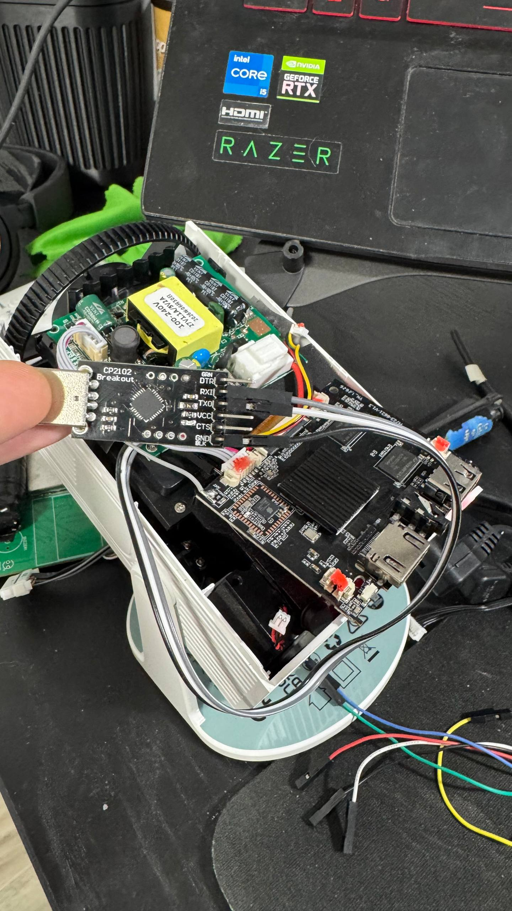
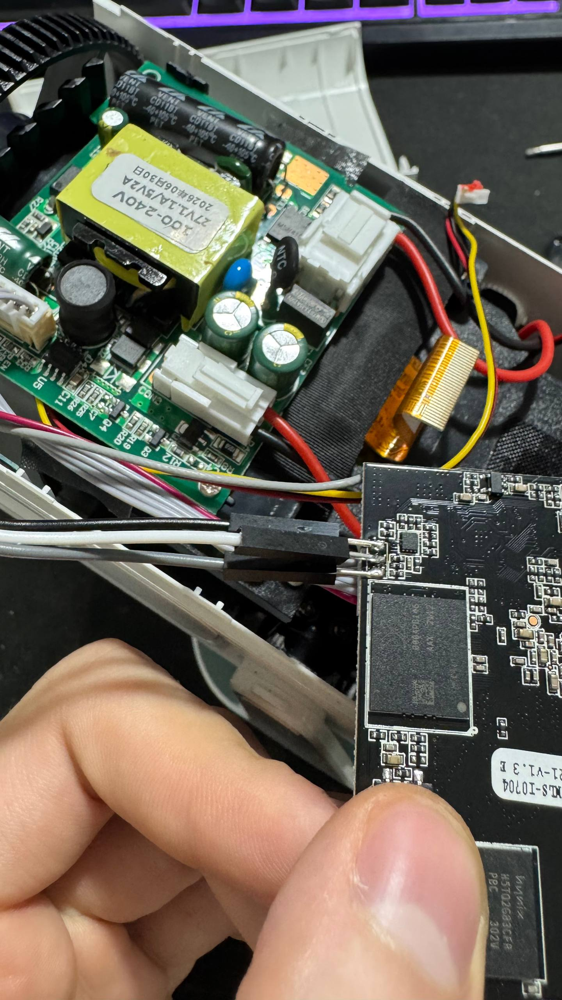
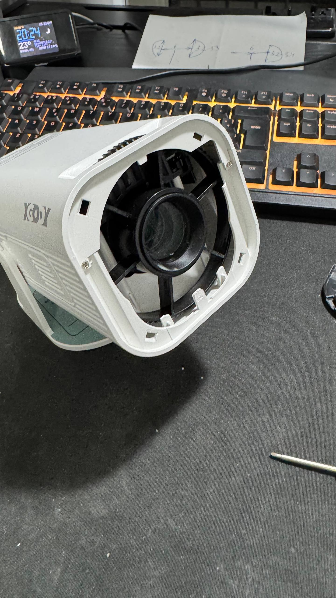
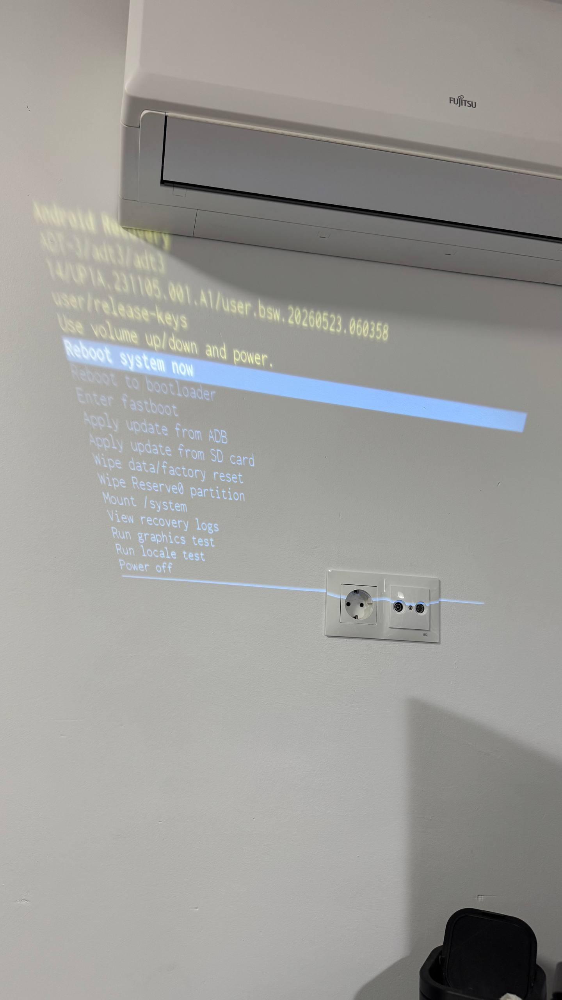
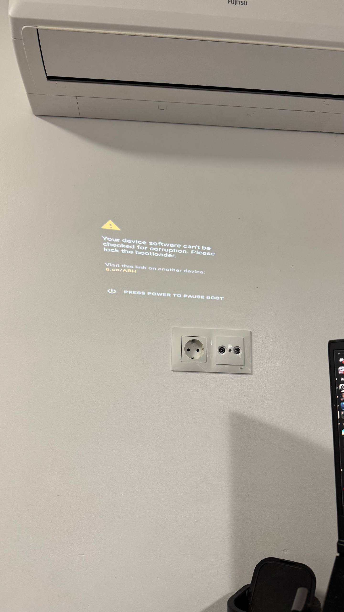
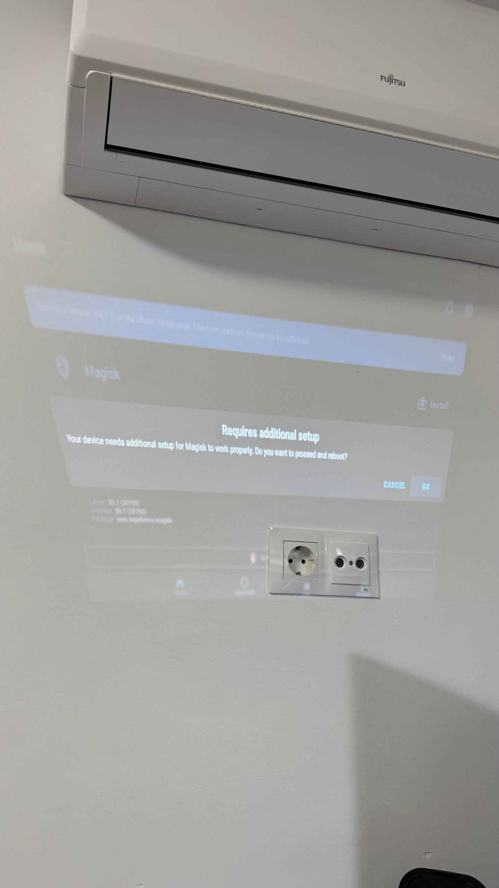
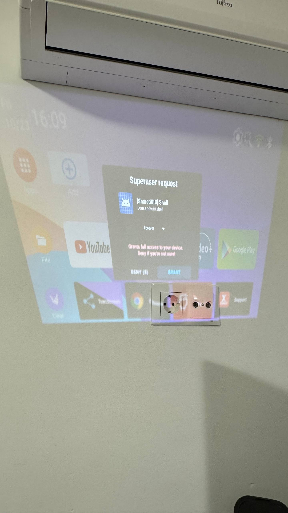

# H723-6621-V1.3 — verified rooting session (23 October 2026)

This is the **second tested hardware revision** of this project, marked **H723-6621-V1.3 / YH_1.2626**. The original README documents the separately tested V1.2 board. Both are Allwinner H723 / `sun50iw15p1` running Android 14; **firmware and Magisk images are device-specific**.

## V1.3 verified facts

| Item | V1.3 result |
|---|---|
| Android | 14 / API 34, `armeabi-v7a` |
| Firmware | `user.bsw.20260523.060358` |
| Active slot | `_a` |
| GPT first 34 sectors | SHA-256 `b852badd4d159cdca67d3bf2acd86feaa0a18bffe87a310666206d4fb8843e05` |
| GPT CRC32 | Header `6ad342cd`, entries `534057f5` |
| `init_boot_a` | LBA `599040`, `16384` sectors, 8 MiB |
| `boot_a` | LBA `205824`, `131072` sectors, 64 MiB — **NOT dumped or patched** |
| Secure Storage | LBA `12288`, 256 sectors / 128 KiB |

The GPT layout matched the tested V1.2, **but the original V1.3 init_boot hash differed**. Never flash a boot image from another revision or device.

### Secure Storage unlocking

The stock Secure Storage SHA-256 was:

`277f5e0163c2bae1f26975215543c3c9998f8b2b9f851a030dcf154d12e7bedc`

The candidate with `device_unlock=unlock` and `fastboot_status_flag=unlocked`, verified against the primary and backup copies, was:

`3ce01845d4d90e3322d4fb03939d1fd7996f7ad4af2ec096716a39e4df9612c6`

`secure_storage_write_uart.py` wrote and verified exactly changed blocks `8,9,10,11,1,0` in that order; full-region readback matched. Cold boot reported `androidboot.vbmeta.device_state=unlocked`, `androidboot.verifiedbootstate=orange`, `androidboot.veritymode=enforcing`. These hashes are **observations, not values to reuse**.

### Patching the V1.3 stock init_boot

Stock `init_boot_a-stock.img`: 8,388,608 bytes, boot v4, kernel 0, ramdisk 3,346,955 bytes.

SHA-256: `624a3a0609ecbc7650d8371e73c5542397923f9e0a23c15e85f3342606a0319c`

Magisk v30.7's graphical "Select and Patch a File" did not produce an output; the GUI invoked `com.softwinner.TvdFileManager`. The successful workaround ran Magisk's **ARM32 `boot_patch.sh`** under normal Android ADB, without Magisk GUI.

Get a trustworthy official Magisk v30.7 APK separately. From the repo root, with the original unmodified `init_boot_a.img` and `..\adb.exe`:

```powershell
python .\scripts\extract_magisk_arm32.py .\Magisk-v30.7.apk
.\patch_init_boot.cmd
python .\scripts\init_boot_inspect.py .\magisk_patched_init_boot_a.img
certutil -hashfile .\magisk_patched_init_boot_a.img SHA256
```

`extract_magisk_arm32.py` merely extracts files from the user-provided APK into `mp/`. `patch_init_boot.cmd` sends tools and the source image over ADB, patches at `/data/local/tmp/mp`, and pulls the output. **Neither flashes eMMC.** No Magisk APK or compiled binaries are distributed in this repository.

The verified patched V1.3 image is 8,388,608 bytes, boot header v4, ramdisk 3,281,800 bytes, Magisk markers `/.magisk`, `PREINITDEVICE=`, `init-ld.xz`.

SHA-256: `e9e9015493ecfa35f77dc5d79363c745033ab9b695a0be47a1b53f0a06898331`.

**Generate your own patched image/hash; never use the example image or hash for another device.**

### Fastboot driver on Windows

`adb reboot bootloader` exposed Allwinner Fastboot `sunxi`: USB `1f3a:1010`; class/subclass/protocol `ff/42/03`; Bulk IN `0x81`, OUT `0x02`.

On the tested Windows host, the default WinUSB driver was visible in Device Manager, but the Python `usb.backend.libusb1` returned `None` and PyUSB did not discover the interface. The **tested working setup** was Zadig → select **sunxi (1F3A:1010)** → **libusb-win32**. Verify that exact USB ID before changing its driver.

```powershell
python -c "import usb.backend.libusb0 as b; print(b.get_backend())"
python -c "import usb.core; print(usb.core.find(idVendor=0x1F3A,idProduct=0x1010))"
```

This returned a `libusb0._LibUSB` object and device descriptor. Driver/backend requirements can differ between hosts; try a suitable backend before replacing an already-working driver.

The hash-gated dry run returned:

```text
> getvar:max-download-size
< 'OKAY0x02000000'
DRY RUN PASS. Would flash init_boot_a. Nothing was written.
```

Only after dry-run, the same `awfastboot_flash.py` command with `--yes` transferred 8 MiB (`download:00800000`) and received `OKAY` for `flash:init_boot_a`. No automatic reboot.

### First boot: finish Magisk setup

After first boot `su` was absent. Opening the Magisk app prompted **"Requires additional setup"** and reboot. After accepting that, a subsequent shell root request triggered Magisk's **Superuser request** dialog. Granting it produced:

```text
uid=0(root) gid=0(root) groups=0(root) context=u:r:magisk:s0
```

This is the verified successful root result on **V1.3**, not just an unlocked bootloader.

### UART transfer interruption

If the Windows host interrupts a `dd | base64` dump, the recovery UART shell may continue streaming. The updated `uart_dump.py` provides progress/ETA, shell readiness checks and remote Ctrl+C handling; do **not** start another dump until the remote shell has responded to a new marker. Avoid the 64 MiB `boot_a` dump entirely in this rooting workflow.

### Photographic evidence — V1.3 (user-uploaded originals)

**Main photo — opened projector, entire H723 board with CP2102 UART adapter:**



**Detailed electronics and UART connection:**



**Projector with front grille removed:**



**Recovery environment:**



**Unlocked bootloader warning (ORANGE):**



**Magisk's additional setup prompt — required after flash:**



**Magisk Superuser authorization of Android shell:**



More uploaded step photos are described in [the image index](../images/README.md). The USB-debugging authorization photo `photo_10_2026-10-23_22-26-02.jpg` contains a readable RSA fingerprint: **do not embed or redistribute it as a clean/redacted example until the string has been blurred**.

### Follow-on work

For the separate custom launcher project, see [XGODY-ADT3-New-Launcher](https://github.com/4TuNAs/XGODY-ADT3-New-Launcher).
